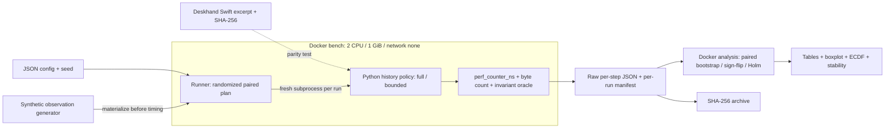

# Архитектура экспериментального стенда

Все экспериментальные компоненты выполняются в контейнерах. Сведения о хосте
собираются до запуска. Swift используется только как дополнительный эталон
соответствия переноса, а не как зависимость основного эксперимента.

Измерение `policy_ms` охватывает только вызов SUT. Генерация, IPC, измерение
байтов и проверка инвариантов в это время не включены. Сеть отключена.
