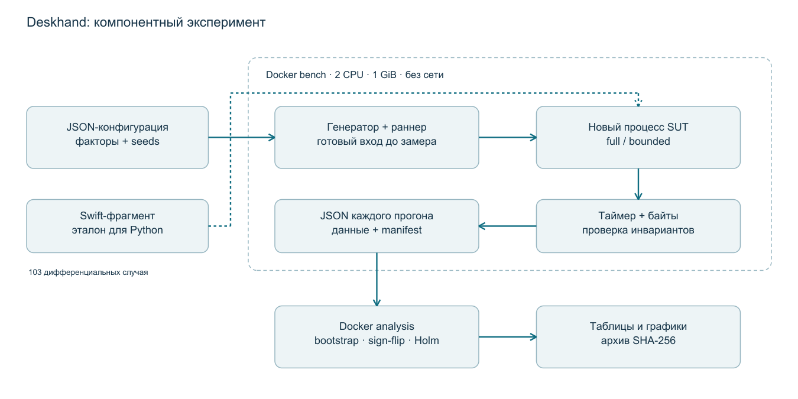
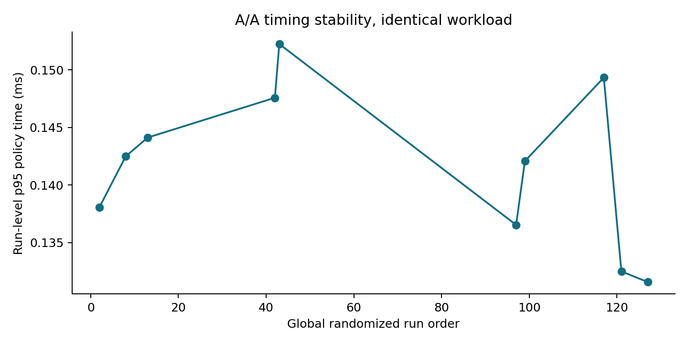
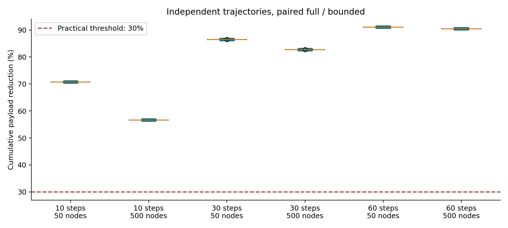
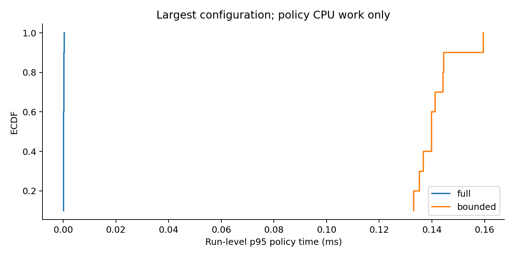

# Практическая работа № 4
## Реализация и оценка экспериментального стенда

**Тема:** сокращение истории наблюдений в AI-ассистенте Deskhand.

**Автор:** Александр Бобрусь. **Дата:** 15 ноября 2026 г.

### 1. Вопрос и границы исследования

Исследовательский вопрос из ПР3: уменьшает ли политика `bounded` накопленный объём полезной нагрузки по сравнению с полной историей, сохраняя последние наблюдения, предусмотренные её контрактом? H₀ — отсутствие систематического сокращения; H₁ — положительный эффект. Практический критерий: нижняя граница 95% интервала медианы сокращения не меньше 30% при выполнении всех структурных инвариантов.

Проведён компонентный эксперимент на Python-порте алгоритма Deskhand. Во всех шести комбинациях длины и размера дерева основной критерий выполнен. Медианное сокращение находится в диапазоне 56,64–91,05%. Повторный полный batch дал точно те же объёмы на каждом шаге и те же проверки сохранности.

Этот результат относится к синтетическим наблюдениям. Он не оценивает выполнение пользовательских задач, поведение модели, токены или стоимость запросов. Тайминги Python-компонента не являются скоростью Swift-приложения. Отдельный контроль A/A показал нестабильность малых временных измерений; поэтому ускорение полного агента не заявляется.

### Что изменилось при реализации

Основной план сохранён: 12 конфигураций, 10 повторений, два прогревочных прохода и 10 A/A-прогонов. Выполнены 20 smoke-прогонов, 130 основных и 130 повторных — всего 280 записей запусков. Дополнительно проведены 11 автоматических тестов и дифференциальная проверка 103 случаев Python/Swift.

При загрузке базового образа Docker Desktop получал TLS timeout. Образ загружен через сеть хоста из официального Docker Registry, SHA-256 каждого слоя проверен, затем образ импортирован в Docker. Сам эксперимент и анализ действительно выполнялись внутри контейнеров. Код и параметры SUT не менялись ради обхода сетевого сбоя.

Второе уточнение — интерпретация времени: исходный план уже предусматривал его вторичную роль. После значимого различия в A/A временной результат оставлен описательным, с явным указанием ограничения. Исходные данные не отбрасывались и не заменялись более удобным запуском.

<!-- pagebreak -->

### 2. Архитектура реализации



Объект измерения изолирован от подготовки данных и анализа. Свежий процесс SUT получает уже материализованный вход, выполняет прогрев и обрабатывает каждое представление истории. После измерения независимые проверки сравнивают сохранённые наблюдения с исходными.

Все обязательные экспериментальные компоненты запускаются через Docker Compose. Сбор характеристик хоста выполняется до запуска контейнеров. Swift-эталон нужен для дополнительной проверки порта; основной эксперимент не требует установки Swift, macOS или разрешений управления интерфейсом.

Исходник диаграммы — `docs/architecture.mmd`; визуализируемая Markdown-версия — `docs/architecture.md`. Архив и отчёт отделены от исходного проекта Deskhand.

<!-- pagebreak -->

### 2. Реализация и фактическое окружение

Архитектура хранится в `docs/architecture.mmd`. В контейнере bench генератор формирует вход, раннер запускает новый процесс `sut.worker`, а тот выполняет прогрев, измеряет политику и проверяет результат. После batch контейнер analysis читает JSON и формирует статистику и рисунки. Данные передаются через общий каталог results; сеть отключена.

| Компонент / параметр | Фактическое значение |
|---|---|
| Хост | Apple M2, Mac14,2, 8 CPU, 8 GiB RAM |
| Docker Engine | 27.4.0, Docker Desktop |
| Docker VM | aarch64, Linux 6.10.14-linuxkit; 8 CPU; 4 109 737 984 байта RAM |
| Лимиты bench / analysis | 2 CPU, 1 GiB на контейнер, последовательный запуск |
| Python контейнера | 3.12.8 |
| Анализ | NumPy 2.2.2, SciPy 1.15.1, Matplotlib 3.10.0 |
| Базовый образ | python:3.12.8-slim-bookworm; манифест и слои в data/base-image.json |
| Измеренный коммит стенда | 5a37523c1a54346ec30eeac5151dff91405e35d7 |
| Ревизия Deskhand | 5514b8226ab47ddfc362360659eff252d22f9c69 |

ID построенного образа: `sha256:eaf63abf00b92854198cca54a3219c790abcd42151fe37a32c27906a10f33917`. Он также записан в манифестах. Lock-файл включает точные транзитивные версии и hashes; установка выполняется с `--require-hashes`.

Главный batch имеет `git_dirty=false`. Во время начала повторного batch был создан неотслеживаемый черновой PDF, поэтому там честно сохранён `git_dirty=true`. Коммит и все SHA-256 измеряемых исходников совпадают; сравнение входов и результатов подтверждено скриптом. Это различие относится к артефакту оформления, а не к версии SUT. Финальные отчёты добавлены после измерений отдельным коммитом.

### Граница измеряемой функции

Таймер охватывает только `apply`: полную историю или её преобразование. Подготовка JSON, создание процесса, подсчёт байтов, проверка инвариантов и запись файлов не входят в `policy_ms`. Они сохраняются/выполняются отдельно. Поэтому очень малая задержка `full` означает возврат уже существующей истории, а не бесплатную передачу её по сети.

<!-- pagebreak -->

### 3. Воспроизведение и данные

Полная инструкция — README. Основная команда: `make experiment`. Параметры находятся в `configs/experiment.json`; сокращённый план — в `configs/smoke.json`.

```sh
make verify
make smoke
make experiment BATCH=review
make experiment BATCH=review-repeat
make analyze BATCH=review
make down
```

Каждая конфигурация имеет 10 независимых seeds траекторий. Варианты full и bounded внутри пары используют одинаковые входы. Длина принимает значения 10, 30, 60; дерево — 50 или 500 узлов. Фиксированы три приложения, 4096 ASCII-символов на изображение-заглушку, 20 строк diff. Порядок всех запусков перемешан; две прогревочные обработки не учитываются.

### Содержимое результата

В JSON каждого прогона находятся `samples` с показателями шагов и `manifest`. Manifest содержит параметры, seed, начало и конец UTC, config hash, dataset hash, hash полного запроса, hashes исходников, Git-коммит, dirty-флаг, версии среды, CPU/RAM и ID образа. Для генератора отдельно записаны CPU/wall-время подготовки и CPU в период ожидания SUT.

Файл `COMPLETE.json` появляется только после успешного завершения всех запусков. Анализ незавершённого batch блокируется. Каталог существующего batch не перезаписывается. Такая схема предотвращает незаметное смешение старых и новых измерений и анализ только «удачно завершившейся» части эксперимента.

Опубликован `data/measured-results.tar.gz`: все 280 сырых записей, планы, метаданные, обработанные таблицы и графики; дополнительно — Swift-проверка и сверка повторяемости. `data/SHA256SUMS` позволяет проверить целостность архива. По конфигурации и seed можно заново сгенерировать точный вход без хранения пользовательских данных.

### Статистический анализ

Для каждой траектории суммируются байты всех отправляемых представлений. Парный эффект R = 1 − B_bounded / B_full. Медиана, IQR и percentile-bootstrap по 5000 выборкам вычисляются на десяти парных эффектах. Точный sign-flip-тест использует 1024 комбинации знаков; поправка Холма охватывает шесть сравнений. Шаги не объявляются независимыми наблюдениями.

В данном генераторе случайность меняет главным образом длины числовых значений, а размеры структур фиксированы. Поэтому узкие интервалы отражают малую вариативность именно этого генератора. Их нельзя считать точностью оценки для всех реальных интерфейсов.

<!-- pagebreak -->

### 4. Проверка самого стенда

| Проверка | Результат | Интерпретация |
|---|---|---|
| Контейнерный smoke | 11 тестов, 20 запусков; завершены | Импорт, SUT, сбор и анализ работоспособны |
| Python / Swift | 103 из 103 случаев совпали | Подтверждён перенос проверенных правил |
| Инварианты | Выполнены во всех 280 запусках | Последние предусмотренные наблюдения сохранены |
| A/A: payload | Идентичен в 10 запусках каждого batch | Нулевой шум счётчика при одинаковом входе |
| A/A: время, main | p = 0,04762 | Контроль времени при α = 0,05 не пройден |
| A/A: время, repeat | p = 0,71429 | Различие не обнаружено; это не доказательство равенства |
| CPU оркестратора | Максимум 30,05% main; 30,91% repeat | Ниже порога 80% одного ядра |
| Повторяемость | 130 из 130 записей совпали по всем payload и инвариантам | Основной результат воспроизводится на том же стенде |

### Калибровка и границы проверок

Функциональные тесты проверяют известную UTF-8-длину, вытеснение старых деревьев, четвёртое приложение, нулевые лимиты, несколько изображений в сообщении, роли сообщений и последний diff. Статистические тесты проверяют ближайший ранг p95, точный результат sign-flip и поправку Холма. Дифференциальный тест компилирует неизменённые тела функций Swift с минимальной оболочкой.

A/A main: разница медиан p95 составляет 0,011042 мс при общей медиане 0,142292 мс; IQR — 0,009792 мс. Таким образом, разброс сравним с межгрупповой разницей. В repeat IQR равен 0,013240 мс. Эти показатели описывают шум времени, но не дают формальный расчёт минимального обнаруживаемого эффекта. На уровне p95 порядка 0,14 мс нужны пакетные измерения и контроль CPU-частоты.

Генератор подготавливает весь вход заранее и не создаёт нагрузку во время измеряемого вызова. Показатель CPU получен как отношение приращения CPU-времени родительского процесса к wall-времени ожидания дочернего SUT. Он включает работу IPC, но не CPU дочернего процесса; это не показание всего контейнера. В офлайн-схеме генератор не может ограничивать интенсивность запросов, поскольку потока запросов нет.

<!-- pagebreak -->

### 4. Стабильность во времени



При одинаковой A/A-нагрузке основной batch дал Spearman ρ = −0,3697, p = 0,2931; повторный — ρ = −0,3212, p = 0,3655. Значимый монотонный тренд не обнаружен, однако десяти наблюдений недостаточно для доказательства отсутствия дрейфа. На графике виден временной разброс, согласующийся с результатом A/A.

Отсутствие тренда и значимое различие случайных групп не противоречат друг другу: разные проверки чувствительны к разным особенностям вариации. Ни один из этих результатов не даёт оснований удалить неудобный прогон. Все записи сохранены в архиве.

Основной результат опирается на точный счётчик байтов, а не на эти временные различия. A/A по байтам прошёл во всех batch. Для времени сделан ограничительный вывод: имеющегося протокола недостаточно для тонкого сравнения производительности. В дальнейшем следует предварительно откалибровать размер пакета вызовов, измерять его целиком и делить на число операций, сохранив исходные времена пакетов.

### Повтор с нуля

Повторный запуск создал новый контейнер bench и новый процесс на каждый из 130 прогонов. Скрипт `scripts/check_repeatability.py` сравнил версии источников, параметры, hashes входов и данные каждого шага. Совпали входные и выходные байты и все инварианты. Тайминги ожидаемо отличаются и не участвуют в проверке точного совпадения.

<!-- pagebreak -->

### 5. Результаты основного эксперимента

В таблице объёмы — медианы накопленных байтов по десяти траекториям; R — медиана парных сокращений. Объём складывается по всем шагам, поэтому это не размер одного последнего промпта.

| Шаги / узлы | Full, байт | Bounded, байт | R, % [95% CI] |
|---|---|---|---|
| 10 / 50 | 355947.0 | 103920.0 | 70.8044 [70.8019; 70.8070] |
| 10 / 500 | 1242583.5 | 538845.0 | 56.6354 [56.6346; 56.6361] |
| 30 / 50 | 3018239.5 | 406122.5 | 86.5444 [86.5441; 86.5448] |
| 30 / 500 | 10609022.0 | 1833162.5 | 82.7207 [82.7205; 82.7211] |
| 60 / 50 | 11899746.0 | 1065163.0 | 91.0487 [91.0485; 91.0491] |
| 60 / 500 | 41973538.5 | 3982355.0 | 90.5122 [90.5121; 90.5123] |

Во всех шести сравнениях исходное двустороннее p = 0,001953; после поправки Холма p = 0,011719. Направление эффекта положительное. Нижние границы bootstrap-интервалов выше 30%; все предусмотренные инварианты сохранены. В рамках заданного синтетического распределения получена поддержка H₁ и выполнен практический критерий.



При 10 шагах и 500 узлах эффект меньше, чем при 50 узлах: сохранение трёх последних крупных деревьев ещё составляет существенную долю короткой истории. По мере роста длины старые наблюдения многократно повторяются в full, а bounded заменяет их компактными маркерами. При 60 шагах сокращение превышает 90% на обоих размерах дерева.

<!-- pagebreak -->

### 5. Время выполнения и смысл выигрыша



Для наибольшей конфигурации медиана p95 самой политики составляет 0,0001665 мс для full и 0,139896 мс для bounded. Преобразование требует дополнительной локальной работы; базовый вариант лишь возвращает ссылку на уже подготовленную историю. Сокращение объёма не следует называть ускорением этой функции.

ECDF построена по одному p95 на прогон, то есть по десяти наблюдениям на вариант. Это не тысячи независимых замеров. p95 вычисляется по ближайшему рангу внутри траектории. На короткой траектории из десяти шагов он равен максимуму; такая оценка хвоста грубая и потому используется только описательно.

Ожидаемая практическая выгода уменьшения контекста возникает за границей данного SUT: сериализация, передача и обработка моделью могут потребовать меньше ресурсов. Здесь эти этапы не измерялись. Более того, кэширование префикса, способ кодирования изображения и токенизатор могут изменить связь между байтами и затратами. Для проверки такого выигрыша нужен отдельный end-to-end-эксперимент с фиксированным провайдером и независимой оценкой результата задач.

### Размер эффекта

Основной размер эффекта — 56,64–91,05% накопленного payload. Он практически интерпретируем без предположения о ценах API. Очень узкие интервалы объясняются узким классом входов, а не исключительной точностью прогноза поведения реального агента. Полученный результат — подтверждение механизма удаления повторяющихся наблюдений на опубликованной нагрузке.

<!-- pagebreak -->

### 6. Сопоставление с исследованиями

| Источник из ПР3 | Что сопоставимо | Что нельзя сопоставлять напрямую |
|---|---|---|
| [1] AutoDroid | Направление: снижение избыточности запросов | Наш payload не равен их точности/завершению задач |
| [2] AutoDroid-V2 | Учёт стоимости контекста и локальной обработки | Скриптовое исполнение и токены не равны удалению старых деревьев |
| [3] OSWorld | Наблюдения и память — существенная часть агента | Компонентный инвариант не заменяет проверку задачи в ОС |
| [4] VisualWebArena | Состав визуального и текстового входа должен фиксироваться | Заглушка изображения не моделирует зрительное понимание |
| [5] WorkArena | Повторения и интервальная оценка | Наши seeds меняют синтетику, а не задачи ServiceNow |
| [6] Mind2Web | Ограничение входного представления и области обобщения | Офлайн-структурная проверка не измеряет качество выбора действий |

Направление эффекта согласуется с идеей устранения избыточного контекста, рассматриваемой в [1, 2, 6]. При этом сходство направления не является численной репликацией. В нашей работе измеряются байты синтетических сообщений; в статьях используются иные представления, задачи и модельные метрики. Поэтому сопоставление абсолютных миллисекунд или процентов успеха было бы некорректным.

Разница порядка величин также ожидаема: локальное преобразование строк занимает доли миллисекунды, тогда как исследования полноценного агента включают дополнительные этапы. Этот стенд не получил измерений inference и не устанавливает численное отношение его времени к локальной обработке.

### 7. Реализовавшиеся угрозы и ограничения

Временной шум действительно проявился: A/A main дал p < 0,05. Обход сетевого сбоя потребовал отдельной загрузки образа, но не изменил его проверенные слои. Повторный batch имеет dirty-флаг из-за чернового PDF; идентичность измеряемого кода проверена hashes. Эти факты сохранены, а не скрыты за итоговой таблицей.

Главная остающаяся угроза — внешняя валидность. Три приложения и регулярное чередование не охватывают длительное отсутствие приложения, ошибки чтения дерева и сложные Unicode-заголовки. Python и Swift различаются представлением строк и временем выполнения. 103 проверенных случая не составляют доказательство универсальной эквивалентности.

<!-- pagebreak -->

### 8. Выводы и развитие стенда

Выполнены контейнеризация, запуск одной командой, вынесенная конфигурация, сохранение сырых измерений и манифестов, программный анализ, A/A и проверка генератора. Полный план повторён с нуля. Подготовлен сокращённый CI-сценарий; локальное выполнение этого сценария проверено. Факт наличия workflow не подменяет успешный статус удалённого GitHub Actions.

В пределах исследованного класса данных bounded уменьшает накопленный payload на 56,64–91,05%. Основной критерий выполнен на всех шести сочетаниях длины и размера дерева, структурные проверки прошли, повтор дал точное совпадение детерминированных показателей. Это достаточное свидетельство корректности измеренного механизма, но не оценка качества ассистента целиком.

Контроль коротких таймингов оказался недостаточно устойчивым. Он выявил проблему, ради обнаружения которой и проводится A/A. Временные данные оставлены в отчёте, но не используются для утверждения об ускорении приложения.

План дальнейшей работы: добавить версии обезличенных реальных наблюдений; варьировать число приложений и характер переключений; отдельно проверять случаи, требующие старой информации; откалибровать пакетные замеры времени. Затем провести ограниченный end-to-end-эксперимент на тестовых окнах с фиксированными моделями и независимым оценщиком конечного состояния. До него вывод об отсутствии потерь в успешности задач остаётся открытым.

### Ответы на вопросы самопроверки

**Каков шум?** Для байтов на фиксированном входе — ноль; для p95 времени A/A main IQR 0,009792 мс. Формальная минимальная обнаруживаемая разница не оценивалась. Нельзя объявлять любую разницу меньше IQR автоматически недоступной или любую большую разницу достоверной.

**Что будет без нового процесса?** Счётчик байтов при неизменном входе сохранится, но allocator, кэши и накопленное состояние могут изменить время. Новый процесс отделяет прогоны; прогрев остаётся одинаковым.

**Как проверить среду?** Сверить Git-коммит и hashes кода/конфига/входа, lock-файл, ID образа, Python, архитектуру, Docker и ресурсы в manifest. Архив проверяется SHA-256.

**Что даст вдвое меньше ядер?** Детерминированные объёмы не изменятся. Стенд выполняет SUT последовательно, поэтому время не обязано удвоиться; возможны иные конкуренция с хостом и планирование. Это проверяется отдельным запуском, а не выводится из числа ядер автоматически.

### Источники

Шесть исследовательских публикаций и их артефакты перечислены в приложении А отчёта ПР3 и `docs/literature.json`. Исходный механизм Deskhand и лицензия — `vendor/deskhand/`. Доказательная база собственных результатов — `data/measured-results.tar.gz`, `data/SHA256SUMS` и сохранённые манифесты.
